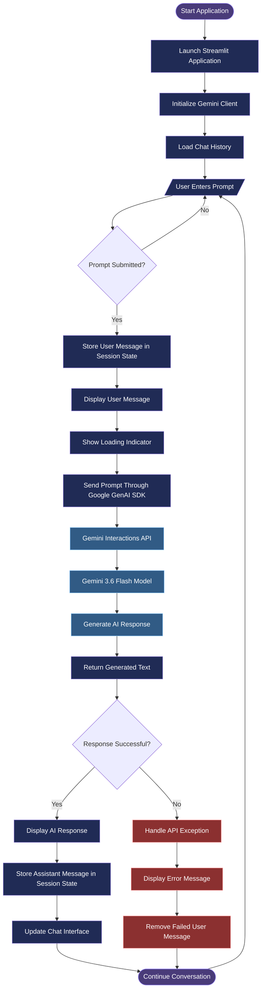
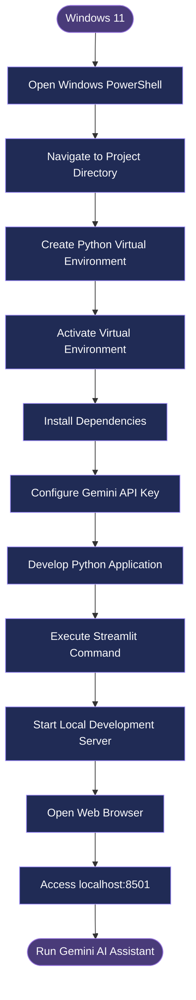

<div align="center">


<br><br>


<br><br>


</div>

---

# 1. Project Overview

**Gemini AI Assistant** is an interactive Generative AI chatbot developed using Python, Streamlit, and Google's Gemini API.

The application allows users to enter questions and receive intelligent AI-generated responses through a modern conversational interface.

It integrates Google's GenAI Python SDK with the Gemini 3.6 Flash model to process user prompts and generate responses.

The application features a customized dark-themed interface, gradient header, interactive chat components, loading indicators, and session-based message history.

The project demonstrates practical implementation of Generative AI, Large Language Models (LLMs), API integration, Python programming, and frontend customization.

# 2. Key Features

* **AI-Powered Conversations:** Generate intelligent responses using Google Gemini.
* **Interactive Chat Interface:** Communicate with Gemini through a Streamlit application.
* **Session-Based Chat History:** Display previous messages during the current application session.
* **Modern User Interface:** Custom dark theme with gradient styling.
* **Loading Indicator:** Visual feedback while Gemini generates responses.
* **Gemini API Integration:** Connect Python applications with Google's AI models.
* **Error Handling:** Handle API errors and display useful error messages.
* **Lightweight Architecture:** Simple and efficient Python implementation.
* **Local Execution:** Run the application on a Windows 11 development environment.

# 3. Technology Stack

| Technology                 | Purpose                                        |
| -------------------------- | ---------------------------------------------- |
| Python                     | Core programming language                      |
| Streamlit                  | Web application and interactive chat interface |
| Google GenAI SDK           | Connects Python with Google's AI models        |
| Gemini 3.6 Flash           | AI response generation                         |
| Gemini Interactions API    | Prompt submission and response retrieval       |
| HTML                       | Custom interface structure                     |
| CSS                        | Dark theme, gradients, and UI styling          |
| Streamlit Session State    | Maintains chat messages during the session     |
| Windows PowerShell         | Development and execution environment          |
| pip                        | Python package management                      |
| Python Virtual Environment | Dependency isolation                           |

# 4. System Architecture

The following flowchart illustrates the complete workflow, from user input to AI-generated response.



## Architecture Components

| Component          | Responsibility                                      |
| ------------------ | --------------------------------------------------- |
| Streamlit          | Provides the interactive web interface              |
| Gemini Client      | Initializes communication with Google Gemini        |
| Session State      | Stores chat messages during the application session |
| Google GenAI SDK   | Connects the Python application to Gemini           |
| Interactions API   | Sends prompts and retrieves AI responses            |
| Gemini 3.6 Flash   | Processes prompts and generates responses           |
| Exception Handling | Handles API errors and displays error messages      |

## Data Flow

1. User enters a question in the Streamlit chat interface.
2. Streamlit captures the submitted prompt.
3. The user message is stored in session state.
4. Python sends the prompt through the Google GenAI SDK.
5. Gemini Interactions API processes the request using Gemini 3.6 Flash.
6. Gemini generates an AI response.
7. The response is returned to the Python application.
8. Streamlit displays the generated response.
9. Chat history is updated for the current session.
10. The user can continue submitting new questions.

# 5. Project Structure

```text
Gemini-AI-Assistant/
│
├── geminiAI.py
│
├── requirements.txt
│
├── README.md
│
└── .gitignore
```

### File Description

| File               | Description                      |
| ------------------ | -------------------------------- |
| `geminiAI.py`      | Main Python application          |
| `requirements.txt` | Required Python packages         |
| `README.md`        | Project documentation            |
| `.gitignore`       | Files excluded from Git tracking |

# 6. Development Environment

The project was developed and executed locally using **Windows 11** and Windows PowerShell.

## Development Workflow



## Commands Executed in Windows 11

### Step 1 — Navigate to Project Directory

```powershell
cd "C:\Users\userName\Downloads\LLM"
```

### Step 2 — Create Python Virtual Environment

```powershell
python -m venv .venv
```

### Step 3 — Activate Virtual Environment

```powershell
.\.venv\Scripts\Activate.ps1
```

### Step 4 — Install Required Dependencies

```powershell
pip install streamlit google-genai
```

### Step 5 — Configure Gemini API Key

Generate an API key through Google AI Studio.

Set the API key in PowerShell:

```powershell
$env:GEMINI_API_KEY = "YOUR_API_KEY"
```

### Step 6 — Execute the Application

```powershell
python -m streamlit run geminiAI.py
```

### Step 7 — Access the Application

Open your web browser and visit:

```text
http://localhost:8501
```

# 7. Installation and Setup

Follow these steps to run the project on your local machine.

### 1. Clone Repository

```bash
git clone YOUR_REPOSITORY_URL
```

### 2. Navigate to Project

```bash
cd Gemini-AI-Assistant
```

### 3. Create Virtual Environment

```bash
python -m venv .venv
```

### 4. Activate Environment

**Windows PowerShell:**

```powershell
.\.venv\Scripts\Activate.ps1
```

### 5. Install Dependencies

```bash
pip install -r requirements.txt
```

### 6. Configure API Key

```powershell
$env:GEMINI_API_KEY = "YOUR_API_KEY"
```

### 7. Run Application

```bash
python -m streamlit run geminiAI.py
```

**Application URL:**

`http://localhost:8501`

# 8. Dependencies

The project uses the following Python packages.

Create a `requirements.txt` file:

```text
streamlit
google-genai
```

# 9. Core Gemini API Implementation

The application uses Google's GenAI SDK to communicate with the Gemini model.

```python
from google import genai

client = genai.Client()

interaction = client.interactions.create(
    model="gemini-3.6-flash",
    input=prompt
)

answer = interaction.output_text
```

### Implementation Explanation

1. Import the Google GenAI library.
2. Initialize the Gemini client.
3. Submit the user's prompt to the Gemini Interactions API.
4. Specify the Gemini 3.6 Flash model.
5. Retrieve the generated response using `interaction.output_text`.
6. Display the response through the Streamlit interface.

# 10. User Interface Design

The application uses custom HTML and CSS styling to create a modern interface.

### UI Components

* Dark navy background.
* Purple gradient header.
* Gemini-inspired branding.
* Interactive chat messages.
* Separate user and assistant chat bubbles.
* Response loading indicator.
* Centered responsive layout.
* Custom typography and spacing.

# 11. Error Handling

The application uses Python exception handling to manage errors during API communication.

```python
try:
    interaction = client.interactions.create(
        model="gemini-3.6-flash",
        input=prompt
    )

    answer = interaction.output_text

except Exception as e:
    st.error(f"Error: {e}")
```

This helps display API-related errors within the application instead of allowing an unhandled exception to interrupt the chat interface.

# 12. Future Enhancements

The following features can be implemented in future versions:

* Persistent conversational memory.
* Previous conversation management.
* Chat export and download functionality.
* Multiple Gemini model selection.
* Voice-based interaction.
* Image understanding.
* PDF and document analysis.
* Custom AI assistant personalities.
* Chat reset functionality.
* Improved conversation management.

# 13. Skills Demonstrated

<div align="center">


</div>

* Python Programming
* Generative AI
* Large Language Models (LLMs)
* Google Gemini API Integration
* Prompt Engineering
* Streamlit Application Development
* API Integration
* HTML and CSS Customization
* Session State Management
* Python Exception Handling
* Virtual Environment Management

---

<div align="center">

## Explore the Power of Generative AI

**Built with Python | Powered by Google Gemini**


</div>
